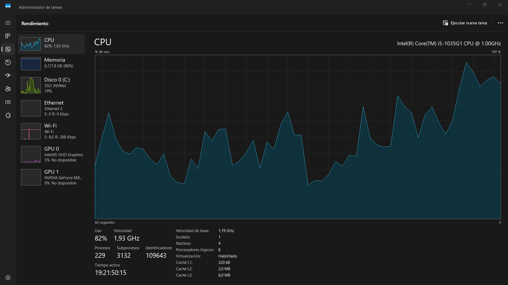
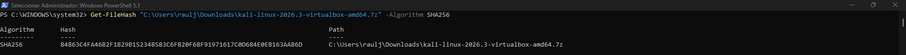
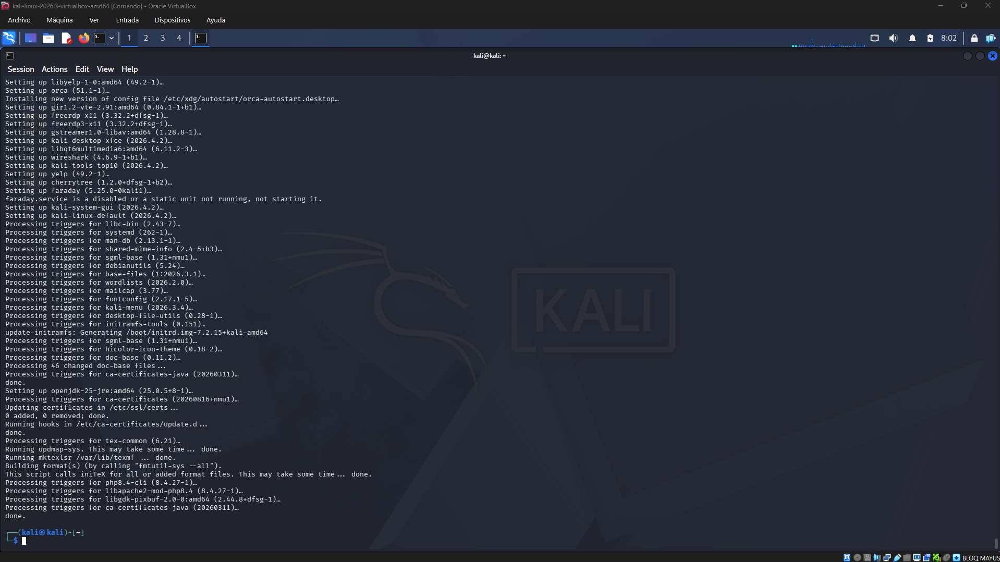
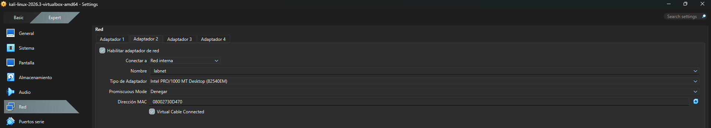
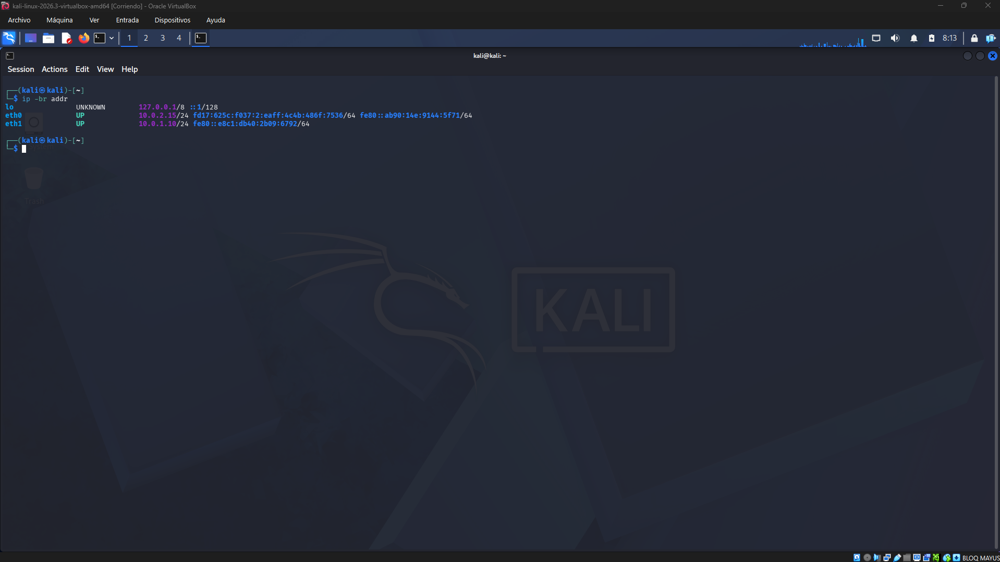
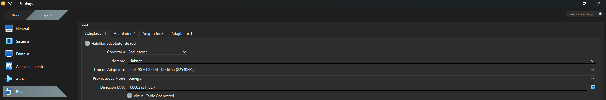
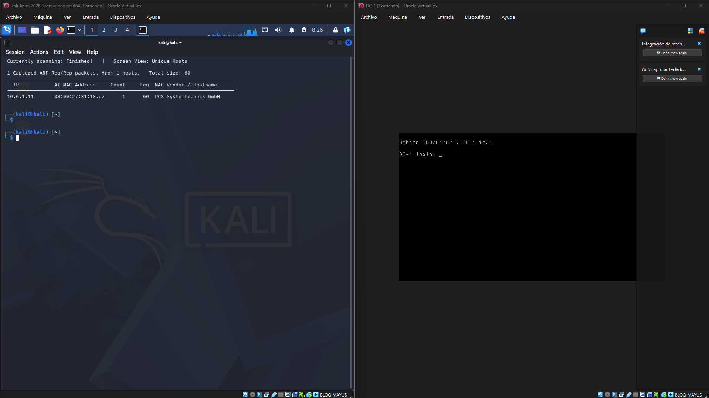
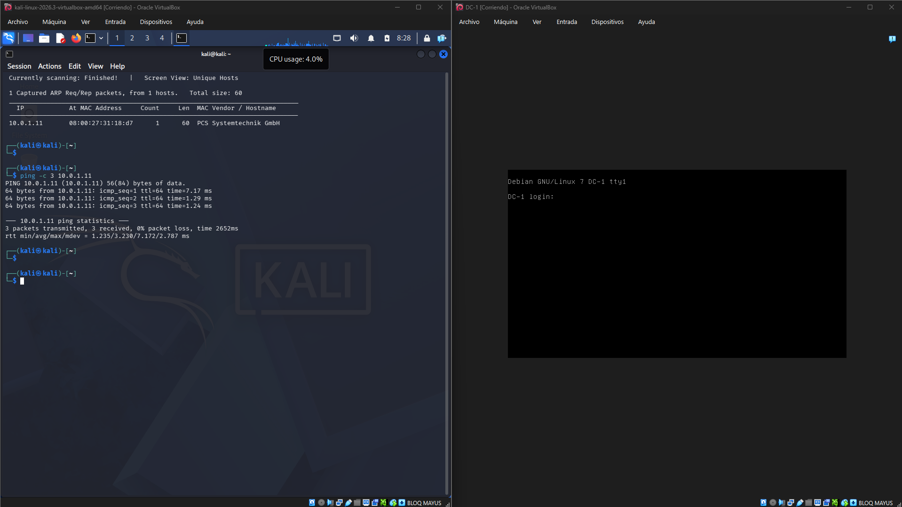
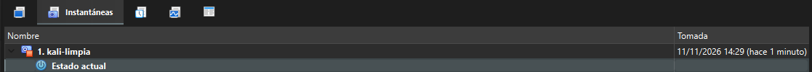
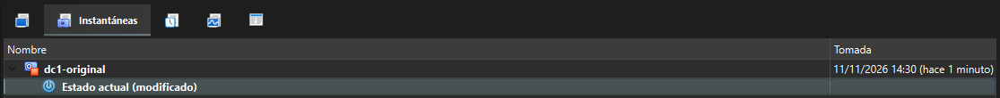

# Misión 0 · Monta tu laboratorio de hacking ético

**Curso:** Curso de Especialización en Ciberseguridad  
**Módulo:** Hacking Ético  
**Unidad:** UD01 · LAB00  
**Autor:** RJM

## 1. Evidencias de los hitos

### H1. Comprobación de requisitos

Se comprobaron los requisitos del equipo anfitrión antes de instalar el entorno virtual. El equipo dispone de 8 GB de RAM, 500 GB de espacio libre y virtualización por hardware habilitada.

### H2. Instalación de VirtualBox e importación de Kali Linux

Se instaló Oracle VirtualBox y se descargó la imagen preconfigurada de Kali Linux para VirtualBox (versión 2026.3).

Antes de importar la máquina virtual, se comprobó la integridad del archivo descargado mediante SHA256, comparando el resultado con el hash oficial publicado por Kali Linux. Ambos valores coincidieron.

Posteriormente, se importó la máquina virtual, se asignaron 4096 MB de RAM y 2 CPU, se cambió la contraseña predeterminada y se actualizaron los paquetes del sistema.

**Verificación SHA256:**

**Actualización de Kali Linux:**

### H3. Creación de la red interna `labnet`

Se creó una red interna denominada `labnet` mediante VirtualBox, utilizando el servidor DHCP integrado para asignar automáticamente direcciones IP a las máquinas virtuales conectadas.

Se configuró el siguiente rango de red:

- Dirección del servidor DHCP: `10.0.1.1`
- Máscara de red: `255.255.255.0`
- Rango de direcciones: `10.0.1.10 - 10.0.1.50`

En Kali Linux se configuraron dos adaptadores de red: el primero en modo NAT y el segundo conectado a la red interna `labnet`.

**Configuración del adaptador de red:**

**Comprobación de las direcciones IP:**

### H4. Importación y aislamiento de DC-1

Se descargó la máquina virtual DC-1 desde VulnHub y se importó en VirtualBox mediante su archivo OVA.

Una vez importada, se configuró su adaptador de red para conectarlo exclusivamente a la red interna `labnet`. Se deshabilitaron los demás adaptadores de red.

De esta forma, DC-1 permanece aislada de redes externas y puede comunicarse con Kali Linux a través de la red interna del laboratorio.

**Configuración de red de DC-1:**

### H5. Comprobación de conectividad

Se comprobó la conectividad entre Kali Linux y DC-1 utilizando las herramientas `netdiscover` y `ping`.

Primero, se utilizó `netdiscover` sobre la interfaz `eth1`, conectada a `labnet`, para descubrir los dispositivos presentes en la red. Se identificó DC-1 con la dirección IP `10.0.1.11` y la dirección MAC `08:00:27:31:18:d7`.

**Descubrimiento de dispositivos con netdiscover:**

Posteriormente, se ejecutó `ping` contra la dirección IP identificada. Se recibieron las tres respuestas enviadas, con un 0 % de paquetes perdidos, confirmando la conectividad entre ambas máquinas.

**Comprobación de conectividad con ping:**

### H6. Creación de instantáneas

Para conservar el estado inicial de las máquinas virtuales y poder recuperarlo en caso de problemas durante futuras prácticas, se crearon instantáneas en VirtualBox.

Se realizaron las siguientes instantáneas:

- **Kali Linux:** `kali-limpia`.
- **DC-1:** `dc1-original`.

Estas instantáneas permiten restaurar las máquinas virtuales al estado guardado sin tener que repetir su configuración inicial.

**Instantánea de Kali Linux:**

**Instantánea de DC-1:**

## 2. Ficha de reflexión

### 2.1. ¿Por qué DC-1 no debe tener adaptador NAT ni puente?

DC-1 es una máquina virtual deliberadamente vulnerable, por lo que no debe disponer de conexión directa con redes externas.

Si utilizáramos un adaptador NAT, podría tener acceso a Internet a través del equipo anfitrión. Si utilizáramos un adaptador puente, estaría conectada directamente a la misma red física que el equipo anfitrión y otros dispositivos.

Esto aumentaría el riesgo de que otros equipos pudieran acceder a sus servicios vulnerables o de que la máquina pudiera interactuar con sistemas ajenos al laboratorio.

Por este motivo, se ha configurado exclusivamente con una red interna (`labnet`), permitiendo la comunicación con Kali Linux sin exponerla directamente a redes externas.

### 2.2. ¿Para qué sirve el servidor DHCP creado en H3?

El servidor DHCP permite asignar automáticamente direcciones IP y otros parámetros de configuración de red a las máquinas virtuales conectadas a `labnet`, evitando tener que configurarlos manualmente.

En esta práctica se configuró para utilizar la dirección `10.0.1.1` como servidor DHCP y asignar direcciones dentro del rango `10.0.1.10 - 10.0.1.50`, con máscara `255.255.255.0`.

Gracias a esta configuración, Kali Linux y DC-1 pueden obtener direcciones IP dentro de la misma red interna y comunicarse entre ellas.

### 2.3. ¿Qué hacen `netdiscover` y `ping`, y qué información proporcionó cada uno?

`netdiscover` es una herramienta de descubrimiento de dispositivos en redes locales que utiliza principalmente solicitudes ARP para identificar los equipos conectados. En esta práctica se ejecutó sobre la interfaz `eth1`, correspondiente a la red `labnet`, y permitió localizar DC-1 con la dirección IP `10.0.1.11` y la dirección MAC `08:00:27:31:18:d7`.

Por otro lado, `ping` permite comprobar si existe conectividad IP con otro dispositivo mediante el envío de paquetes ICMP Echo Request y la recepción de respuestas Echo Reply.

Al ejecutar `ping -c 3 10.0.1.11`, Kali recibió las tres respuestas enviadas y obtuvo un resultado de 0 % de pérdida de paquetes. Esto confirmó que existía comunicación entre Kali Linux y DC-1.

## 3. Bitácora de uso de IA

Durante la preparación del laboratorio apareció un problema al iniciar Kali Linux en VirtualBox: la máquina virtual mostraba un error de tipo **Kernel panic** y no completaba el arranque.

Se consultó a una herramienta de inteligencia artificial para obtener orientación sobre las posibles causas del error y conocer qué parámetros de VirtualBox podían revisarse para intentar solucionarlo.

Durante el diagnóstico se comprobaron diferentes opciones de configuración:

- Controlador gráfico: VMSVGA.
- Memoria de vídeo: 128 MB.
- Aceleración 3D: desactivada.
- Paravirtualización: predeterminada.

Finalmente, se desactivó la opción **Nested Paging** (paginación anidada) en la configuración de VirtualBox. Después de realizar este cambio, Kali Linux consiguió arrancar correctamente.

La experiencia permitió comprobar que las recomendaciones de una IA deben contrastarse mediante pruebas reales. Es necesario revisar la configuración, probar posibles alternativas y verificar que los cambios solucionan realmente el problema, en lugar de aplicar las sugerencias de forma automática.

**Valoración del uso de IA:** la herramienta sirvió como apoyo durante el diagnóstico, aunque la identificación de la configuración adecuada requirió realizar comprobaciones directamente en VirtualBox. No se identificó ningún error concreto de la IA durante este proceso.